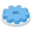
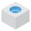

import {ExplainedCode} from '@site/src/components/docs/ExplainedCode';
import standoffModule from '!!raw-loader!./_examples/standoff.feature.js';
import standoffPlate from '!!raw-loader!./_examples/standoff-pcb-plate.part.js';

# Custom Features

A custom feature is a feature type your project defines: a PCB standoff, a vent grid, a fastener hole, a gear. You write it once in a `*.feature.js` file, and from then on it works like a built-in feature. The toolbar offers it with its own icon, dialog and preview. **Apply** writes the statement, the History panel shows its row, and models call it in code.


Write one when a construction of several steps keeps coming back with different values, and should be one statement and one History row. Several cases don't need one:

- **Geometry that occurs once:** write the statements in the model.
- **The same geometry again in one model:** use [Repeat or Copy](/docs/patterns/repeat).
- **A whole part reused with other dimensions:** use a [part with parameters](/docs/part/param).
- **Something a built-in already does:** check first. [Hole](/docs/3d-operations/hole) already cuts clearance, tapped, counterbored and countersunk holes.

This page writes a standoff from the starter file, then uses it from the toolbar and in code. Three more pages go further:

- [Inputs](/docs/custom-features/inputs): every kind of value a dialog can ask for, and how to lay the rows out.
- [Building the Geometry](/docs/custom-features/geometry): what `buildTool()` can build, the preview, and features that follow what they are picked at.
- [Named Faces and Edges](/docs/custom-features/named-faces-and-edges): names of a feature's own, such as a gear's tooth tips.

## Writing a feature

A standoff is a boss with a hole through it, standing on a face: the post a circuit board is screwed to. Its dialog asks for the face and three sizes, and models fillet its rim and repeat it at the corners of a plate.

### 1. Create the file

In the editor, click **+**, type `standoff` and pick **Create feature**. FluidCAD writes `standoff.feature.js`, and the feature is in the **Custom** dropdown at once. The file starts as a working feature: a boss standing on a picked face.

```js title="standoff.feature.js, as Create feature writes it"
import { Feature, defineFeature } from 'fluidcad/sdk';
import { Primitives, ShapeOps } from 'fluidcad/sdk/kernel';
import { Matrix4 } from 'fluidcad/math';

// The values the feature takes: one picked face and two typed-in lengths.
// The dialog shows one row per value, in this order.
export class Standoff extends Feature.with({
  face: { picker: 'face', label: 'On face', surface: 'planar' },
  diameter: { type: 'length', default: 6, min: 0 },
  height: { type: 'length', default: 10, min: 0 },
}) {
  // The feature's type: it names the feature in every timeline.
  static id = 'standoff';

  // Returns the solids the feature adds; FluidCAD fuses them with the part.
  buildTool() {
    const { diameter, height } = this.values;
    const faces = this.facesOf(this.values.face);
    if (faces.length !== 1) {
      throw new Error(`standoff: pick one planar face to stand on (got ${faces.length} faces)`);
    }
    // Built standing on the XY plane, then placed on the picked face.
    const plane = faces[0].getPlane();
    const origin = plane.projectPoint(faces[0].center());
    const frame = Matrix4.fromBasis(plane.xDirection, plane.yDirection, plane.normal, origin);
    const boss = Primitives.makeCylinder(diameter / 2, height);
    const placed = ShapeOps.transform(boss, frame);
    boss.dispose();
    return [placed];
  }
}

// Describes the feature for the toolbar's Custom menu and its dialog, and
// returns the builder a model calls: standoff(face, { diameter, height }).
export const standoff = defineFeature(Standoff, {
  label: 'Standoff',
  group: 'create',
  operations: ['add', 'new'],
  call: ['face', { diameter: 'diameter', height: 'height' }],
});
```

Every feature file has the same four parts:

| Part | What it is |
|---|---|
| `Feature.with({ … })` | The feature's inputs: one entry per value the dialog asks for. |
| `static id` | The feature's type, a plain name. It can't be one of FluidCAD's own types (`extrude`, `fillet`, `part`, …). |
| `buildTool()` | Builds the solid the feature adds or cuts. FluidCAD fuses it with the part, keeps it apart or cuts it, as the statement says. |
| `defineFeature(Class, { … })` | Describes the feature for the toolbar and the dialog, and returns the function models call. Export it by name. |

The next steps turn the boss into a standoff, one part at a time.

### 2. Declare the inputs

A standoff needs a hole, and its rows should read as a standoff's. Replace the values with these four:

```js
export class Standoff extends Feature.with({
  face: { picker: 'face', label: 'On face', surface: 'planar' },
  height: { type: 'length', default: 10, min: 0 },
  outer: { type: 'length', default: 6, min: 0, label: 'Boss diameter' },
  hole: { type: 'length', default: 3, min: 0, label: 'Hole diameter' },
}) {
```

Each entry is one row of the dialog, in the order they are listed. The **Add / New** tabs and the **Scope** row come from the feature's operations (step 5), and **Preview** is its preview toggle.

<div style={{display: 'flex', flexWrap: 'wrap', gap: '1.5rem', alignItems: 'flex-start', marginBottom: 'var(--ifm-leading)'}}>

<div style={{flex: '1 1 18rem'}}>

- **`picker`** makes a value something the user clicks in the viewport. `face` takes faces, and with `surface: 'planar'` the dialog refuses a face that isn't flat.
- **`type`** makes a value something the user types in. A `length` is a number in the model's unit.
- **`label`** is the row's caption. Without one, the row shows the name made readable: `height` reads **Height**.
- **`default`** is what a row left alone holds. A call may leave the value out and gets the default.
- **`min`** keeps the value in range. A model that passes `height: -2` fails to compile with `standoff(): 'height' must be at least 0, got -2`.

</div>
</div>

`buildTool()` reads them from `this.values`: `height`, `outer` and `hole` are numbers, and `face` is a selection, read through `this.facesOf()`. Numbers, toggles, choices with pictures, text, the other pickers and the dialog's layout are all on the [Inputs](/docs/custom-features/inputs) page.

### 3. Build the geometry

`buildTool()` returns the solids the feature makes. Build them standing on the XY plane, from `z = 0` up, then move them onto the picked face:

```js
buildTool() {
  const { height, outer, hole } = this.values;
  if (!(hole < outer)) {
    throw new Error(`standoff: the hole (${hole}) must be narrower than the boss (${outer})`);
  }
  const faces = this.facesOf(this.values.face);
  if (faces.length !== 1) {
    throw new Error(`standoff: pick one planar face to stand on (got ${faces.length} faces)`);
  }
  const plane = faces[0].getPlane();
  const origin = plane.projectPoint(faces[0].center());

  // Built standing on the XY plane: the boss, with the bore cut out of it.
  const boss = Primitives.makeCylinder(outer / 2, height);
  const bore = Primitives.makeCylinder(hole / 2, height);
  const tube = BooleanOps.cutShapes(boss, bore);
  boss.dispose();
  bore.dispose();

  // Then placed on the picked face.
  const frame = Matrix4.fromBasis(plane.xDirection, plane.yDirection, plane.normal, origin);
  const placed = ShapeOps.transform(tube, frame);
  tube.dispose();
  return [placed];
}
```

Add `BooleanOps` to the `fluidcad/sdk/kernel` import. Three habits keep a feature well behaved:

- **Check what the inputs can't.** `min` can't say that the hole must be narrower than the boss. Throw an error that names the feature and the fix. The statement's History row fails with that message, and the rest of the model still builds.
- **Dispose every shape you build and drop:** here the two cylinders the cut consumed, and the tube once it is moved. Never dispose the shapes you return.
- **Read picks only through the helpers** (`facesOf()`, `axisOf()`, `frameOf()`, …). The preview hands the feature stand-ins for the picks, not the scene's own objects.

The kernel's shapes, placing several tools at once, cuts, the preview and raw OpenCascade are on the [Building the Geometry](/docs/custom-features/geometry) page.

### 4. Name its faces

A model that fillets the standoff's top rim writes `post.endEdges()`, as it would on an extrude. That only works when the feature says which of its faces are which. Sort the faces while the tube still stands on the XY plane, place it with `ShapeOps.transformTracking`, and name the faces they became with `setBuckets()`:

```js
// Sorted on the XY plane: the bottom face, the top face, the outer and the inner wall.
const tolerance = 1e-6 * Math.max(height, outer);
const all = tube.getSubShapes('face');
const start = all.filter(f => Math.abs(f.getBoundingBox().maxZ) < tolerance);
const end = all.filter(f => Math.abs(f.getBoundingBox().minZ - height) < tolerance);
const walls = all.filter(f => !start.includes(f) && !end.includes(f));
const side = walls.filter(f => f.getBoundingBox().maxX > hole / 2 + tolerance);
const internal = walls.filter(f => !side.includes(f));

const frame = Matrix4.fromBasis(plane.xDirection, plane.yDirection, plane.normal, origin);
const placed = ShapeOps.transformTracking(tube, frame, all);
tube.dispose();
// Each group as the faces it became once placed.
const [startFaces, endFaces, sideFaces, internalFaces] = [start, end, side, internal]
  .map(group => group.map(f => placed.images[all.indexOf(f)]).filter(f => f !== null));

this.setBuckets({
  startFaces,
  endFaces,
  sideFaces,
  internalFaces,
  startPlane: new Plane(origin, plane.xDirection, plane.normal),
});
return [placed.shape];
```

- The names are an extrude's: `startFaces` where the feature meets what it grew from, `endFaces` at its far end, `sideFaces` round it and `internalFaces` inside it, such as a bore.
- Edges follow from the faces: the edges of the end faces are the end edges, so `post.endEdges()` is the top rim.
- Without `setBuckets()`, `post.endEdges()` holds nothing, and a fillet on it fails.

A feature can also name parts of its own: a gear's tooth tips, so that `pinion.tipEdges()` rounds every tooth. See [Named Faces and Edges](/docs/custom-features/named-faces-and-edges).

### 5. Describe it for the toolbar

`defineFeature()` gives the toolbar and the dialog what they show, and says how a model calls the feature:

```js
export const standoff = defineFeature(Standoff, {
  label: 'Standoff',
  description: 'A boss with a bore through it, standing on a planar face',
  icon: './standoff.svg',
  group: 'create',
  operations: ['add', 'new'],
  call: ['face', { height: 'height', outer: 'outer', hole: 'hole' }],
});
```

| Field | Meaning |
|---|---|
| `label` | The name in the Custom dropdown and on the feature's History rows. Required. |
| `description` | The tooltip in the dropdown. |
| `icon` | The feature's picture: an image next to the file. See the next step. |
| `group` | `'create'` or `'modify'`. The dropdown lists create features first. Required. |
| `operations` | What the statement may do with what `buildTool()` returns: `'add'` fuses it into the part, `'new'` keeps it a body of its own, `'remove'` cuts it. The dialog shows them as tabs. A statement with no `.add()`, `.new()` or `.remove()` applies `add` when the feature offers it, else the first one listed. A feature with `['remove']` alone cuts with no tabs and no chain. |
| `call` | How a model calls the feature. Required (below). |
| `ghost` | How the dialog previews it: `'toggle'` (the default) behind a **Preview** toggle, `'always'` from the start with no toggle, `false` never. |

**The call.** `call` lists the arguments in order: the values passed by position, then one object of options. The standoff's call is `standoff(face, { height, outer, hole })`. A model writes it like this:

```js
standoff(pad.endFaces(), { outer: 6, hole: 3.2 });
```

- Every value appears in `call` exactly once.
- What the user picks comes first, by position. Sizes go in the object of options, where a call names only the ones it changes.
- The dialog writes its statements with the same `call` and reads them back with it, so a statement the dialog wrote is always one it can edit.

The [Inputs](/docs/custom-features/inputs#the-call) page has the remaining forms: a list of picks spread over the last arguments, and a pick a call may leave out.

### 6. Give it an icon

The icon shows in the Custom dropdown, at the top of the feature's dialog, on its History rows, on a pinned package's toolbar group and on the hub. Without one, the feature gets a generic solid. Put an image next to the file and name it in `icon: './standoff.svg'`. The path is relative to the feature file, never `../` or a URL. SVG, PNG, JPEG and WebP all work.

| Standoff | Gear | Fastener hole | Vent grid |
|:-:|:-:|:-:|:-:|
|  |  |  |  |

An icon that sits well beside the built-in ones:

- **Draws what the feature makes, in the toolbar's style.** The built-in icons show a small isometric part in light grey, with what the feature adds or cuts in blue. The standoff is a blue tube on a grey plate. The fastener hole is a grey block with the hole's faces in blue.
- **Reads at 28 pixels.** That is the size of a toolbar button. Draw on a square canvas (`viewBox="0 0 64 64"`, like the toolbar's own), keep one bold shape, and leave out text and thin lines.
- **Reads in the light and the dark theme.** The icon is shown as a picture, so `currentColor` draws black, and black disappears on the dark toolbar. Use fixed colours. The built-in palette is below.
- **Holds everything itself.** An SVG that loads a font or another image shows it missing.

| | Top | Left side | Right side |
|---|---|---|---|
| Grey: the part | `#e5e6e7` | `#d8d9da` | `#c6c7c8` |
| Blue: what the feature makes | `#74bff0` | `#4faae5` | `#3f91c9` |

The standoff's icon is a few shapes. An isometric circle of radius `r` is an ellipse `r × 1.22` wide and `r × 0.71` tall, so a tube is two ellipses joined by its sides:

```xml title="standoff.svg"
<svg xmlns="http://www.w3.org/2000/svg" viewBox="0 0 64 64" width="64" height="64">
  <defs>
    <linearGradient id="tube" x1="0" x2="1">
      <stop offset="0" stop-color="#5cb2ea"/>
      <stop offset="1" stop-color="#3f91c9"/>
    </linearGradient>
  </defs>
  <!-- The plate: grey, its top lightest, its right side darkest. -->
  <path d="M4 40 L32 23.8 L60 40 L32 56.2 Z" fill="#e5e6e7"/>
  <path d="M4 40 L32 56.2 V60.2 L4 44 Z" fill="#d8d9da"/>
  <path d="M32 56.2 L60 40 V44 L32 60.2 Z" fill="#c6c7c8"/>
  <!-- The standoff: what the feature makes, in blue. -->
  <path d="M21 14 V40 A11 6.35 0 0 0 43 40 V14 Z" fill="url(#tube)"/>
  <ellipse cx="32" cy="14" rx="11" ry="6.35" fill="#74bff0"/>
  <ellipse cx="32" cy="14" rx="5" ry="2.9" fill="#3a86bb"/>
</svg>
```

The pictures of a dialog's choices and the drawings beside it follow the same rules. See [Pictures](/docs/custom-features/inputs#pictures).

### The whole file

<ExplainedCode code={standoffModule} fileName="standoff.feature.js" title="standoff.feature.js" open />

### While you work on it

- **Saving the file rebuilds it.** Every statement that uses the feature rebuilds, in every open model, with no restart. An open dialog's preview redraws with the saved code.
- **FluidCAD finds it by its exports.** Every `*.feature.js` file in the project is read, outside `node_modules`, dot folders and gitignored paths. Each **named** export that `defineFeature()` returned is offered in the Custom dropdown. A default export is skipped, and nothing is registered in `init.js`.
- **The file is read again on every render.** Keep no state at the top of the file between renders, and never test `x instanceof Standoff`: each render makes the class anew. FluidCAD compares two statements by their id and their values.
- **It runs in the engine.** The page only receives the description. Node built-ins such as `fs` or `child_process` are blocked in feature files, as in models.

A feature that can't be offered shows as a greyed entry in the dropdown, with the reason as its tooltip: a file that fails to load, a file that exports no feature, or two features with one id. The other mistakes show where they happen:

| What went wrong | Where it shows |
|---|---|
| A field FluidCAD doesn't know (`surfce: 'planar'`) | The feature is greyed in the dropdown, and a model importing it fails to compile with the message. |
| A call the feature can't read (a negative height, a missing value, an unknown option) | The model fails to compile: `standoff(): 'height' must be at least 0, got -2`. |
| `buildTool()` throws or returns nothing | That statement's row fails with the message. The rest of the model builds. |
| `setBuckets()` gets a name the feature doesn't have, or faces of a shape `buildTool()` doesn't return | That statement's row fails: `gear: setBuckets() 'tipFace' is not a bucket of gear — did you mean tipFaces?` |
| An operation the feature doesn't offer (`.remove()` on the standoff) | That statement's row fails, naming the operations it offers. |

## Using a feature

### From the toolbar

1. Click **Custom**, the last button on the part toolbar. It lists every custom feature of the project, with its icon.
2. Click a feature. Its dialog opens docked on the right, one row per input. The standoff's has the **Add / New** tabs, **On face** (click a face in the viewport), **Height**, **Boss diameter**, **Hole diameter** and a **Scope** row.
3. Turn on **Preview** to see the result as a ghost: green for what the feature adds, red for what it cuts. The toggle remembers it was turned on for that feature. A feature with `ghost: 'always'` previews from the start, with no toggle.
4. Click **Apply**. The statement and its import are written into the file, and the History panel gains a row with the feature's name and icon.

The statement under the dialog shows what Apply will write. Only the values you changed are written, because a row left alone holds the default the feature fills anyway.

Double-click the row to edit the feature. The dialog opens on the statement's values (**Edit standoff**), and Apply rewrites the statement.


### In code

The written call is plain code: a model imports the feature from its file and calls it. Later features use its faces like any other. Below, a fillet rounds the standoff's top rim through `post.endEdges()`, and a repeat copies the pad, the standoff and the fillet to the plate's other three corners.


<ExplainedCode code={standoffPlate} fileName="pcb-plate.part.js" />

- A value left out takes its default: this standoff is 10 tall.
- The operation is a chain, as on a built-in: `standoff(face).new()` keeps the standoff a body of its own, and `.scope(…)` limits what it fuses with.
- A [repeat](/docs/patterns/repeat) builds the feature again at each copy, from the same picks.

### Parameters in a dropdown

A dropdown row of a feature's dialog takes a [parameter](/docs/part/param) the way a number row does. The fastener hole below offers its screws as a dropdown (**Screw**: M3, M4, M5). The part declares `holeSize`, a `param('Hole size', 'm4', 'select', { options: [...] })` with the same values.

1. Open the dropdown. Under the options, a **Parameters** group lists every variable of the part the row can take, with the option its current value selects beside it. `holeSize` is `'m4'`, so the row reads **M4**.

   

2. Click it. The button shows the parameter's name with the option it resolves to muted beside it, and the preview draws that option. The statement reads `fastener(…, { size: holeSize })`: the name, written bare, as a number row writes `extrude(height)`.

   

3. To unbind it, open the dropdown again and pick an option. Apply writes the literal, `size: 'm5'`.

- **Typing** in the search box filters the options and the parameters together. A name that matches neither is offered as a **new** row, as a number row offers a fresh name. <kbd>Enter</kbd> declares it with the option the row shows, `const holeSize = param('holeSize', 'm3', 'select', { options: [...the row's options] })` at the top of the part body, and uses it in the statement. The **P / V** chip on the row works as on the number rows: off, the declaration is a plain `const holeSize = 'm3'`.
- **Only matching parameters are listed.** A dropdown of string options lists string parameters and constants (`select`, `text`, a `const finish = 'deburr'`). Numeric options list number parameters, and a dropdown that holds several options lists list values (`const fin = ['deburr']`). A number never appears in a string dropdown. A parameter whose current value is not one of the options is still listed, in the warning colour. Binding it refuses Apply with the reason (`Screw: finish is 'deburr', which is not one of the options.`) until the value or the binding changes.
- **Buttons and cards have no parameter path.** They show every option at once and hold no list. Declare a dropdown (`select`) when a value should be bindable.
- **Editing** a statement written by hand as `size: holeSize` opens with the bound button. Any other expression (`a ? 'm4' : 'm5'`) leaves the statement not editable from the dialog.

## Sharing a feature

A feature file serves the project it lives in. To use it in other projects, or give it to someone, put it in a [package](/docs/packages). **New Package** on the start screen makes one, with a `features/` folder for the feature files and their pictures and a `parts/` folder for the parts that should travel. The top bar's **Publish** button puts it on the hub ([Publishing](/docs/packages#publishing)). For a project that already holds the files, `npx fluidcad package init --name @<your handle>/<name>` writes the package block; move the files into the folders yourself. Installed elsewhere from the hub, the package's features appear in the Custom dropdown under the package's name.

## Limits

- Custom features run in part files and part bodies, not at the top level of an assembly.
- The dialog is built from the declared inputs. A feature can't add controls of its own.
